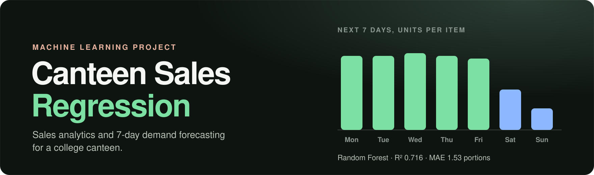
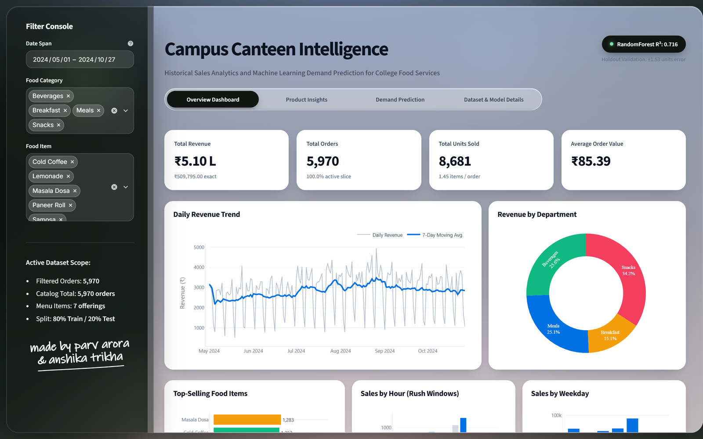
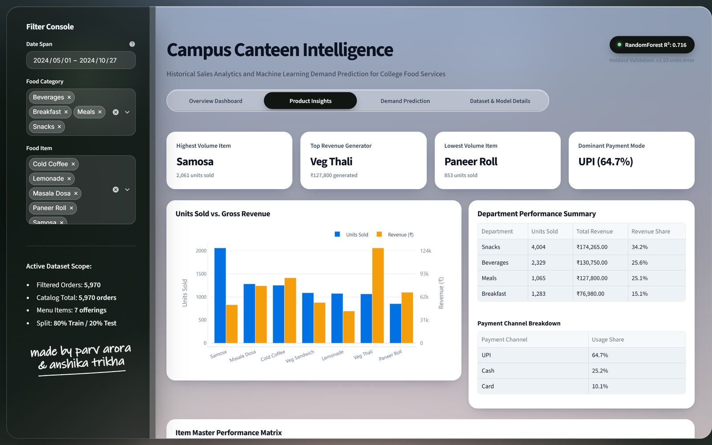
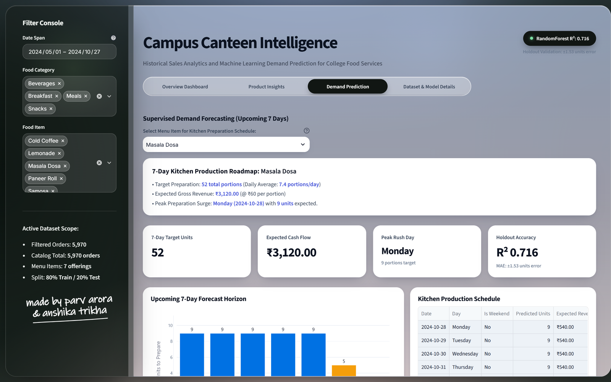
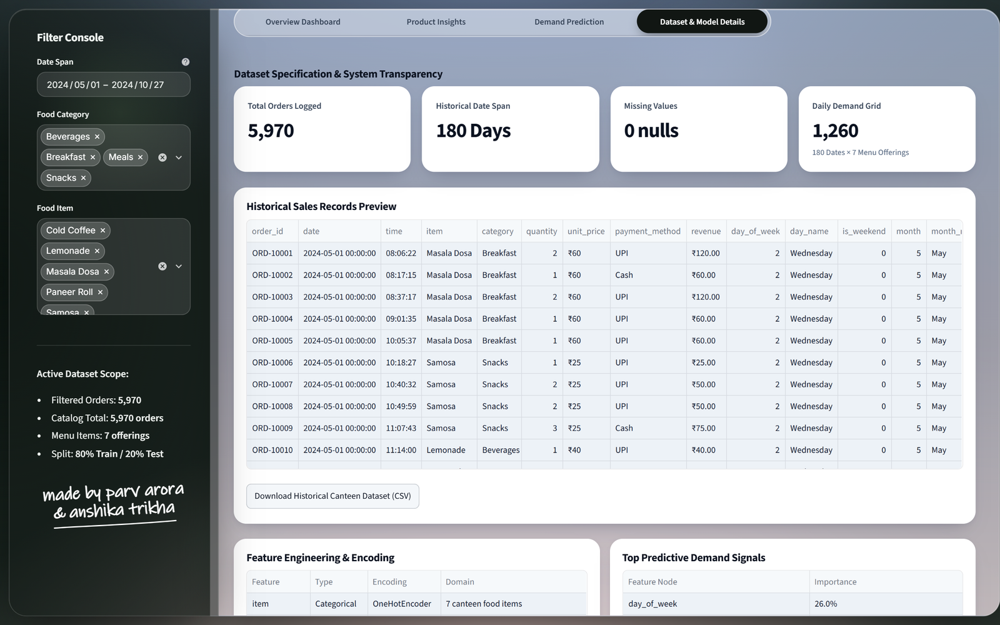

<p align="center">
  
</p>

<p align="center">
  <strong>Sales analytics and Random Forest demand forecasting that tells a college canteen how many portions of each item to cook over the next 7 days.</strong>
</p>

<p align="center">
  
  
  
  
</p>

<p align="center">
  <a href="#results">Results</a> &bull;
  <a href="#screenshots">Screenshots</a> &bull;
  <a href="#how-the-model-works">Model</a> &bull;
  <a href="#dashboard">Dashboard</a> &bull;
  <a href="#getting-started">Quickstart</a> &bull;
  <a href="#limitations">Limitations</a>
</p>

---

## Overview

Canteens cook too much and waste food, or cook too little and sell out. Demand follows the timetable and the day of the week: roughly 58 units a day across the menu on weekdays, 27 on Saturdays and 19 on Sundays in the test period.

This project turns **5,970 orders over 180 days and 7 menu items** into a per-item daily demand table, trains a scikit-learn Random Forest on it, and serves the forecast through a Streamlit dashboard so a kitchen can read off a 7-day preparation plan.

**Authors:** Parv Arora (2401420008) and Anshika Trikha (2401420044)

---

## Results

Scored on the last 36 days, which the model never sees during training.

| Model | R² | MAE (units) |
| :--- | :---: | :---: |
| Predict the overall mean | 0.00 | 2.67 |
| Predict the per-item mean | 0.30 | 2.35 |
| Linear regression | 0.62 | 1.79 |
| **Random Forest (used)** | **0.716** | **1.53** |

| Metric | Value | Reading |
| :--- | :---: | :--- |
| **Test R²** | **0.716** | The model explains about 72% of the variation in daily demand |
| **Test MAE** | **1.53 units** | A forecast is off by roughly one and a half portions per item per day |
| **Train R²** | 0.81 | Small gap to the test score, so overfitting is mild |

> The three baseline rows are not produced by the app. They were computed separately on the same split to give the Random Forest score some context.

---

## Screenshots

### Overview
Revenue, orders, units and average order value, with the revenue trend, hourly rush windows and weekday pattern.
<p align="center">
  
</p>

### Product Insights
Volume against revenue per item. Samosa sells the most units; Veg Thali earns the most revenue.
<p align="center">
  
</p>

### Demand Prediction
Pick an item and get the 7-day kitchen plan with units, expected revenue and the peak day.
<p align="center">
  
</p>

### Dataset and Model Details
The feature table, feature importances and the raw records behind the model.
<p align="center">
  
</p>

---

## How the model works

| Step | What happens |
| :--- | :--- |
| **1. Data** | `data/generate_data.py` produces a synthetic order log with a fixed seed (42): 180 days from 1 May to 27 Oct 2024, 7 items, meal-time rushes, a weekend drop and semester seasonality. Real canteen billing data is not public. |
| **2. Demand table** | Orders are aggregated to 180 days × 7 items = **1,260 rows**. Days an item did not sell are filled with 0; leaving them out would show the model only days with sales and push predictions upward. |
| **3. Features** | `item`, `category`, `day_name` (one-hot encoded); `unit_price`, `month`, `day_of_week`; `is_weekend`. The target is `quantity_sold`. |
| **4. Split** | Chronological, not random. The first 144 days (1,008 rows) train the model; the last 36 days (252 rows) test it. A shuffle would leak future days into training. |
| **5. Pipeline** | One scikit-learn `Pipeline`: a `ColumnTransformer` for the encoding, then a `RandomForestRegressor`. |
| **6. Output** | Predictions are clipped at zero and rounded to whole portions, then multiplied by unit price for expected revenue. |

**Random Forest settings:** 100 trees, `max_depth=12`, `min_samples_split=4`, `min_samples_leaf=2`, `random_state=42`.

Why a forest: demand drops in steps at the weekend, which trees split on cleanly and a straight line cannot; averaging 100 trees keeps one noisy day from swinging the forecast; and feature importances keep it explainable. With 1,260 rows, a neural network would have too little data to learn from.

---

## Dashboard

| Tab | Contents |
| :--- | :--- |
| **Overview** | KPI cards, revenue trend with a 7-day moving average, sales by hour and weekday, revenue by category |
| **Product Insights** | Volume against revenue, category shares, payment methods |
| **Demand Prediction** | Per-item 7-day preparation schedule with units, expected revenue and peak day |
| **Dataset and Model Details** | Raw records, feature table, feature importances, sample CSV download |

The sidebar filters by date range, category and item, and every chart updates with it.

---

## Menu in the dataset

| Item | Category | Price | Demand pattern |
| :--- | :---: | :---: | :--- |
| **Masala Dosa** | Breakfast | ₹60 | Morning peak, smaller dinner bump |
| **Veg Sandwich** | Snacks | ₹50 | Steady from 10 AM to 6 PM |
| **Paneer Roll** | Snacks | ₹80 | Lunch and evening |
| **Veg Thali** | Meals | ₹120 | Heavy lunch rush, highest revenue |
| **Samosa** | Snacks | ₹25 | Highest volume, evening tea rush |
| **Cold Coffee** | Beverages | ₹70 | Midday and afternoon |
| **Lemonade** | Beverages | ₹40 | Midday |

---

## Getting started

Requires Python 3.10 or newer.

```bash
git clone https://github.com/Parv-spamz/canteen-sales-regression.git
cd canteen-sales-regression
pip install -r requirements.txt
python -m streamlit run app.py
```

The app opens at `http://localhost:8501`. On Windows, `run.ps1` or `run.bat` does the same. To rebuild the dataset: `python data/generate_data.py`.

---

## Repository layout

```text
canteen-sales-regression/
├── app.py                   # Streamlit dashboard
├── requirements.txt
├── run.ps1 / run.bat        # Windows launchers
├── assets/                  # Banner and README screenshots
├── data/
│   ├── canteen_sales.csv    # Generated order log
│   └── generate_data.py     # Seeded dataset generator
└── src/
    ├── data_processing.py   # Loading, validation, demand-table aggregation
    ├── analytics.py         # KPIs, rush-hour stats, product rankings
    └── model.py             # Pipeline, training, 7-day forecast
```

---

## Limitations

- The data is synthetic, so the scores show how well the pipeline recovers the patterns we generated, not how it would do on a real canteen.
- Features are calendar and item information only. Weather, exams, events and holidays are not modelled.
- One fixed chronological split, with no cross-validation or hyperparameter search.

Next steps: weather and event calendars, quantile regression for a safety buffer, time-series cross-validation, and live billing data with automatic retraining.

---

<p align="center">
  Built by <strong>Parv Arora</strong> and <strong>Anshika Trikha</strong>
</p>
